  

  

  

 

## 👨‍💻 About Me

  

  

 

---

## 🏆 Featured Projects

<table align="center" width="100%">
  <tr>
    <td width="50%" valign="top">
      <h3 align="center">🗳️ <a href="https://github.com/SmoothnOperator/decentrivote-app">DecentriVote</a></h3>
      

        
        
        
        
      

      
Decentralized electronic voting web application designed for transparent, tamper-proof on-chain elections.

    </td>
    <td width="50%" valign="top">
      <h3 align="center">🖥️ <a href="https://github.com/SmoothnOperator/OS-Visual-Simulation">OS Visual Simulation</a></h3>
      

        
        
        
      

      
Interactive Operating System simulation platform visualizing CPU scheduling, memory management & DMA modes.

    </td>
  </tr>
  <tr>
    <td width="50%" valign="top">
      <h3 align="center">🏥 <a href="https://github.com/SmoothnOperator/CarePulse-Hospital-Appointment-Prototype">CarePulse</a></h3>
      

        
        
        
      

      
Hospital appointment booking prototype built with modern design thinking principles for seamless patient healthcare access.

    </td>
    <td width="50%" valign="top">
      <h3 align="center">🛡️ <a href="https://github.com/SmoothnOperator/simd-defense-system">SIMD Defense System</a></h3>
      

        
        
      

      
Interactive SIMD Defense System HUD visualizing vector pipelining, lockstep execution & parallel processing.

    </td>
  </tr>
</table>

 

---

## 🛠️ Tech Stack & Skills

  

 

---

## 📊 GitHub Contributions

  

 

---

## 🎯 Opportunities & Status

  
  -blue?style=for-the-badge)
  

  
<i>Actively building decentralized protocols & modern web applications. Open to junior/intern roles & open-source contributions.</i>

 

  

 

---

## 🔗 Connect with Me

  
  &nbsp;&nbsp;
  

  

